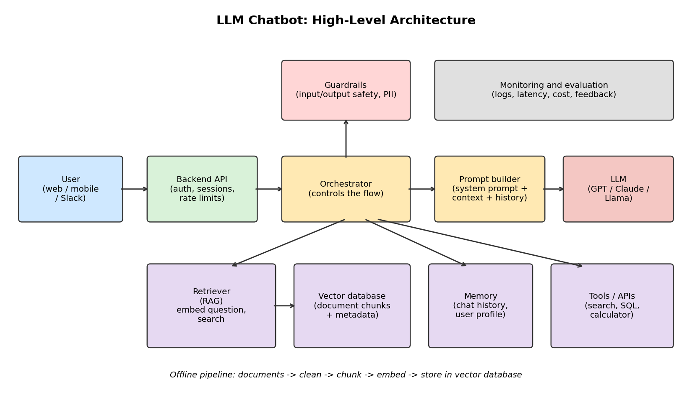

# Assignment 2: LLM, Chatbot Architecture and Vector Databases

**Name:** Shashank S M

---

## Question 1: Self-rating

> A = can code independently, B = can code under supervision, C = little or no understanding

| Area | Rating | Reason |
|---|---|---|
| Machine Learning (ML) | **A** | I can independently build, train and evaluate models such as regression and classification. |
| Deep Learning | **B** | I understand neural networks, CNNs and RNNs and can code them with reference material or guidance. |
| Artificial Intelligence (AI) | **B** | I understand the core concepts and applications and can implement them with guidance. |
| Large Language Models (LLM) | **B** | I understand prompting, embeddings and RAG, and can build a basic chatbot with guidance. |

*(Ratings above are my honest self-assessment. LLM tooling changes quickly, so I rate myself B and plan to move to A by building more end-to-end projects.)*

---

## Question 2: Key architectural components of an LLM-based chatbot

### Approach in one paragraph

A user sends a message through an interface. A backend receives it and an orchestrator decides what is needed: past conversation, relevant company documents, or a tool such as a database query. It assembles all of this into a prompt, sends it to the LLM, checks the answer with safety guardrails, and returns it. The most important design pattern is **Retrieval-Augmented Generation (RAG)**, which lets the model answer from our own data instead of relying only on what it memorised during training.

### Components

| # | Component | Purpose | Typical choices |
|---|---|---|---|
| 1 | **User interface** | Where the user chats; shows streamed replies | Web app, mobile app, Slack, WhatsApp |
| 2 | **Backend / API layer** | Authentication, sessions, rate limiting, routing | FastAPI, Flask, Node.js |
| 3 | **Orchestration layer** | Controls the steps for each message (retrieve, call tools, call the LLM) | LangChain, LlamaIndex, custom code |
| 4 | **Prompt management** | A system prompt sets role, tone and rules; templates combine question, history and context | Prompt templates, versioning |
| 5 | **Memory** | Short-term: recent turns of the conversation. Long-term: user preferences, summaries | In-context history, Redis, SQL |
| 6 | **Knowledge retrieval (RAG)** | Finds relevant information from private documents | Embedding model + vector database + optional reranker |
| 7 | **The LLM** | Generates the final answer | GPT, Claude, Gemini, Llama, Mistral |
| 8 | **Tools / function calling** | Lets the bot act: search, run SQL, call APIs, calculate | Function calling, MCP, REST APIs |
| 9 | **Guardrails** | Blocks unsafe input/output, masks personal data, resists prompt injection | Moderation filters, validation rules |
| 10 | **Monitoring and evaluation** | Tracks quality, latency, cost and user feedback | Logging, LangSmith, dashboards, test sets |
| 11 | **Infrastructure** | Hosting, caching, storage, deployment | Cloud, Docker, CI/CD |

### The RAG pipeline in detail

**Offline (done once, and again when documents change):**
1. Load documents (PDF, web pages, databases).
2. Clean the text and split it into chunks (for example 300 to 500 tokens, with some overlap).
3. Convert each chunk to a vector with an embedding model.
4. Store the vectors and metadata (source, date, department) in a vector database.

**Online (for every question):**
1. Convert the user's question to a vector with the same embedding model.
2. Search the vector database for the top-k most similar chunks (optionally filtered by metadata).
3. Insert those chunks into the prompt as context.
4. The LLM writes an answer grounded in that context and can cite the sources.

### Key design considerations
- **Hallucination:** reduce it with RAG, clear instructions to say "I don't know", and citations.
- **Latency and cost:** use streaming, caching, and a smaller model for simple questions.
- **Security and privacy:** access control on documents, PII masking, and guarding against prompt injection.
- **Evaluation:** build a test set of questions with expected answers and measure accuracy regularly.

---

## Question 3: Vector databases

### What is a vector database?

An **embedding model** converts text, images or audio into a list of numbers called a **vector**, arranged so that items with similar meaning are close together in space. A **vector database** stores these vectors and quickly answers: *"which stored items are closest to this query vector?"*

A normal database matches exact values or keywords. A vector database matches **meaning**. For example, the query "forgot my login" can find a document titled "account recovery steps", even though they share no words.

### How it works

- **Similarity measures:** cosine similarity, dot product or Euclidean distance.
- **Approximate Nearest Neighbour (ANN) indexes:** comparing a query with every vector is too slow at scale, so databases use indexes such as **HNSW** (a layered graph) or **IVF** (clusters). They trade a very small amount of accuracy for large speed gains.
- **Metadata filtering:** results can be restricted, for example "only HR documents from 2025".
- **Common uses:** RAG chatbots, semantic search, recommendations, duplicate detection, image search.

A small runnable illustration is in `demo/toy_vector_search.py`. It builds vectors, ranks documents by cosine similarity, and applies a metadata filter.

### Hypothetical problem

**An HR assistant chatbot for a company of about 5,000 employees.** It must answer questions from around 20,000 policy documents (roughly 500,000 chunks).

Requirements:
- Answers in under one second.
- Filtering by country and department.
- Role-based access, because some documents are confidential.
- Self-hosted, because the data cannot leave the company.
- Moderate budget.

### My choice: Qdrant (self-hosted)

| Reason | Why it matters here |
|---|---|
| Fast HNSW search | Meets the under-one-second target at 500,000 vectors |
| Strong metadata filtering | Country and department filters are core requirements |
| Open source and self-hostable | Confidential HR data stays inside our own environment |
| Handles millions of vectors on modest hardware | Room to grow, with predictable cost |
| Simple API and good Python and LangChain support | Faster to build and maintain |

### Alternatives considered

| Option | Strengths | Why not chosen here |
|---|---|---|
| Pinecone | Fully managed, no operations work | Data leaves our environment; ongoing usage cost |
| pgvector (PostgreSQL) | One database for everything; simple | Good at this size, but weaker for heavy filtered search as data grows |
| Chroma / FAISS | Excellent for prototypes | Not designed for production needs like access control and clustering |
| Milvus / Weaviate | Very scalable | More operational complexity than 500K vectors requires |

**Note:** if the company already runs PostgreSQL and the data stays small, pgvector would be a simpler reasonable choice. If the data grew to hundreds of millions of vectors, Milvus or a managed service would be worth reconsidering.

---

## References

- Lewis et al., *Retrieval-Augmented Generation for Knowledge-Intensive NLP Tasks* (2020): https://arxiv.org/abs/2005.11401
- Malkov and Yashunin, *Efficient and robust approximate nearest neighbor search using HNSW graphs* (2016): https://arxiv.org/abs/1603.09320
- Qdrant documentation: https://qdrant.tech/documentation/
- pgvector: https://github.com/pgvector/pgvector
- Pinecone learning center: https://www.pinecone.io/learn/
- LangChain documentation: https://python.langchain.com/docs/
